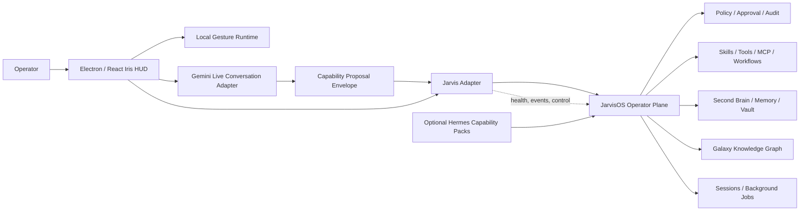
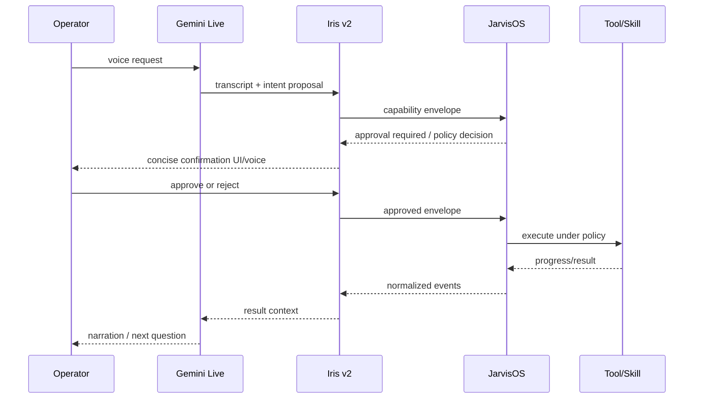

# Iris v2 — Architecture and Ownership

## 1. Boundary diagram



The renderer never talks directly to arbitrary tools, files, shells, browsers,
or provider credentials. All operator actions pass through the JarvisOS
capability boundary.

## 2. Four planes

### Presentation plane — Iris v2

Owns the transparent Electron window, Glass UI, orb/status treatment, task
cards, reader overlay, camera dock, gesture reticle, session/brain controls and
galaxy graph visualization. It owns interaction state, not canonical work state.

The presentation plane may cache a short-lived view model for responsiveness,
but every task, session, brain, memory and permission state must be refreshable
from JarvisOS.

### Conversation plane — Gemini Live

Owns low-latency speech input/output, turn-taking, interruption, transcript
rendering and natural-language interpretation. It can ask clarifying questions
and produce a typed capability proposal. It cannot execute a filesystem,
browser, shell, messaging or external side effect directly.

When Gemini is unavailable, the plane falls back to JarvisOS's text/TTS path and
announces the degraded mode in the HUD.

### Operator plane — JarvisOS

Remains the single authority for:

- brain selection, second brain, memory, vault and knowledge graph;
- sessions, task lifecycle, background jobs and cancellation;
- skills, tools, MCP, workflows, agents and provider routing;
- policy, approval, authentication, secrets and audit records;
- REST/WebSocket contracts consumed by Iris v2.

Iris v2 must not reimplement these systems. If a Jarvis feature is missing from
the adapter, add an adapter endpoint/view or improve JarvisOS itself rather than
creating a local substitute.

### Optional capability plane — Hermes

Hermes is treated as a source of capability packs, patterns and isolated
workers. Candidate additions include skill provenance/AST audits, lazy tool
discovery, output limits, delegated/background work, project isolation,
permission prompts, session search and observability. Each pack must map to the
Jarvis capability model and can be disabled without taking down the operator
plane.

## 3. Runtime ownership

There is exactly one JarvisOS runtime per data root.

Target launch modes:

1. **Attached:** Iris v2 discovers a healthy local JarvisOS endpoint and uses it.
2. **Managed:** Iris v2 asks the approved runtime launcher to start one JarvisOS
   process, waits for health, and owns only the child-process lifecycle.
3. **Embedded-shell option:** if the existing JarvisOS desktop shell is selected
   as the production host, Iris v2 is a renderer package loaded by that shell.

The product owner selected a standalone Iris v2 executable and an attached-only
Phase 1. Managed mode remains disabled until its later singleton, data-root,
authentication, shutdown, and rollback gates are explicitly approved. The
embedded-shell option is not the Phase 1 host. Every future mode still obeys
one backend, one canonical data root, and one migration path; a renderer restart
must not spawn a duplicate backend.

## 4. Adapter boundary

The `JarvisAdapter` is the only operator-facing client. It should expose typed
methods such as:

```ts
interface JarvisAdapter {
  health(): Promise<HealthSnapshot>;
  sendTurn(input: TurnInput): Promise<{ sessionId: string }>;
  stopTurn(input: { sessionId: string; runId?: string }): Promise<void>;
  listSessions(): Promise<SessionSummary[]>;
  listBrains(): Promise<BrainSummary[]>;
  memoryStats(): Promise<MemoryStats>;
  graphSnapshot(input: GraphQuery): Promise<GraphSnapshot>;
  listCapabilities(): Promise<CapabilitySummary[]>;
  subscribe(listener: (event: JarvisEvent) => void): Unsubscribe;
}
```

The transport details and normalized events live in
[docs/contracts/jarvis-adapter.md](docs/contracts/jarvis-adapter.md). A future
Jarvis API change should require a contract fixture update, not scattered UI
patches.

New Jarvis skills/tools/workflows are inherited through the live capability
catalog and version negotiation described in
[docs/contracts/capability-discovery.md](docs/contracts/capability-discovery.md).
Iris v2 does not claim to support a capability merely because a similarly named
button exists; availability and policy come from the connected Jarvis runtime.

## 5. Event normalization

Jarvis events are mapped as follows:

| Jarvis event | Iris v2 view model |
|---|---|
| `hello` | backend identity, protocol version, capabilities |
| `status` | connection/task status indicator |
| `tool_call` | task card step enters running/awaiting state |
| `tool_result` | step result, provenance and risk badge |
| `stream` | incremental reader/transcript text |
| `response` | completed assistant turn |
| `error` | recoverable/error card with retry context |
| `system` | diagnostics, policy or provider notice |
| `turn_done` | turn idle/completed marker |

Unknown events are retained in a diagnostic channel and never treated as a
successful completion. Ordering is preserved per `session_id` and `run_id`.

## 6. Gemini-to-Jarvis flow



For low-risk read-only operations, Jarvis policy may auto-approve according to
the operator's configured policy. The UI must still show what happened. Gemini
output, retrieved web text and skill instructions are untrusted input and must
not change policy.

## 7. Data ownership and state

| State | Owner | Renderer handling |
|---|---|---|
| Session/run IDs | JarvisOS | retain in an adapter store; reconcile on reconnect |
| Brain ID/path | JarvisOS | use opaque IDs; never accept arbitrary absolute paths |
| Memory/vault records | JarvisOS | query/render only |
| Gesture confidence/pose | local gesture runtime | ephemeral; never persisted by default |
| Transcript display | Iris v2 + Gemini adapter | short-lived UI state; durable history remains in approved session store |
| Approval decision | JarvisOS policy/audit | display immutable status and provenance |
| Hermes pack metadata | JarvisOS registry or approved pack store | display version/provenance/enablement |

## 8. Failure and recovery model

- **Gemini disconnect:** keep the Jarvis session alive; show reconnecting and
  offer text/TTS fallback.
- **Jarvis disconnect:** freeze side-effect controls, preserve unsent draft,
  reconnect with the same session ID, and reconcile status before resubmitting.
- **Gesture camera/model failure:** disable gesture affordances, keep mouse and
  voice controls, never infer intent from stale pose data.
- **Optional Hermes worker failure:** mark only its capability unavailable;
  cancel/clean its child process and keep Jarvis core usable.
- **Renderer crash/restart:** runtime supervisor prevents duplicate backend
  startup and rehydrates state from Jarvis.

## 9. Security invariants

1. Secrets stay in the main/runtime/backend boundary.
2. Capability envelopes are validated server-side; renderer fields are hints.
3. UI gestures can select or request but never elevate risk.
4. Browser navigation, IPC senders and local origins are allowlisted.
5. Every external side effect has an audit event and idempotency key.

See [SECURITY.md](SECURITY.md) and
[docs/contracts/capability-envelope.md](docs/contracts/capability-envelope.md).
