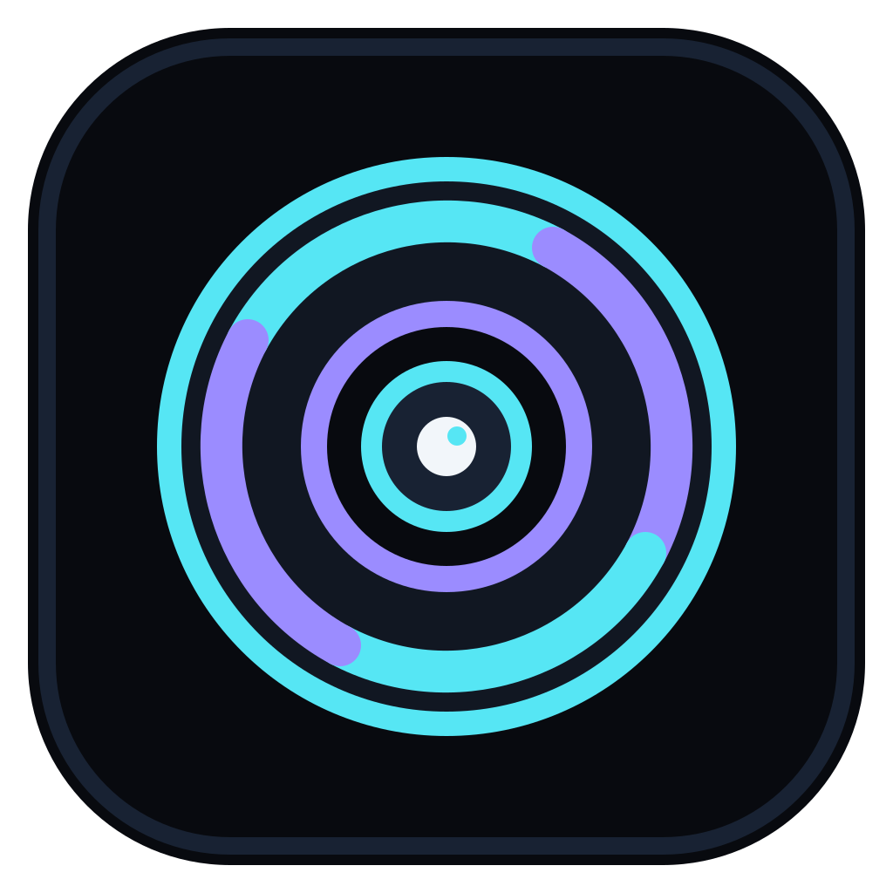
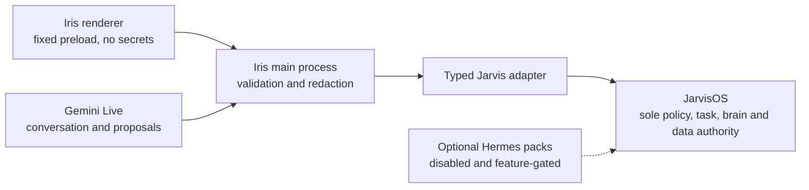

# Iris v2

<p align="center">
  
</p>

<p align="center">
  <strong>A calm, transparent Windows cockpit for governed local AI.</strong><br>
  Talk naturally, inspect the Second Brain and follow real task progress while
  one JarvisOS runtime remains the authority for policy, memory and execution.
</p>

<p align="center">
  <a href="https://github.com/Meunieur/iris-v2/actions/workflows/ci.yml"></a>
  <a href="LICENSE"></a>
</p>

> **MVP Core preview.** The default product is intentionally small: Electron
> HUD + local gestures + an attached JarvisOS runtime + read-only Second Brain.
> Gemini, task execution, workflows, MCP/provider controls and Hermes remain
> preserved as opt-in extension work until each Jarvis-owned boundary is
> verified. See [the MVP scope](docs/execution/MVP_SCOPE.md).

## Why Iris v2

Most AI desktop experiments split conversation, memory, tools and status across
separate surfaces. Iris v2 starts with one focused operator experience without
turning the renderer or a model into a second authority:

- a transparent Glass HUD for ambient status and quick interaction;
- a full Command Deck for runtime status, sessions and the Galaxy knowledge
  view;
- local, permission-aware hand gestures with mouse and keyboard equivalents;
- an attached JarvisOS runtime that remains authoritative for brains, sessions,
  policy, memory and audit;
- explicit offline, sign-in, degraded, replay, stop and recovery states.

The first success criterion is simple: run the core tests, open the package,
sign in manually, load the Second Brain and use the HUD. Advanced surfaces are
documented as an extension backlog rather than treated as hidden completion
work.

## The authority boundary



JarvisOS owns process policy, authentication, secrets, sessions, brains,
memory, vault, skills, tools, MCP, workflows and audit. Gemini can propose an
intent; it cannot approve or execute one. Hermes remains an optional capability
source behind a typed, disabled-by-default boundary.

## What is verified today

| Surface | Current evidence | Remaining gate |
|---|---|---|
| Secure Electron shell | Packaged Windows app, narrow preload, denied navigation and one attached Jarvis runtime | Fresh public release install matrix |
| Glass HUD and Command Deck | Keyboard, focus, click-through, reduced-motion, camera lifecycle and target-scale checks | Four physical gestures, actual 200% DPI and a second display |
| Gemini bridge | Bounded audio/transcript lifecycle, reconnect tests and proposal-only boundary | Owner-authorized live provider and conversation review |
| Galaxy Second Brain | Opaque IDs, bounded read-only graph projection and packaged UX | Fresh protected login and human readability review |
| R0 Jarvis tasks | 442 Iris tests, 4 HTTP integration tests, 32 companion Jarvis tests and packaged UI evidence | Merge/restart approval and a protected real worker/stop/recovery run |
| Build supply chain | Zero known production vulnerabilities; the complete audit graph is checked against one exact, development-only advisory exception | Replace the legacy Electron Builder chain or re-review the exception by 2026-08-14 |

The exact evidence and unresolved debt live in
[the execution status](docs/execution/STATUS.md) and
[the Phase 4 verification report](docs/execution/reports/2026-07-31-phase-4-r0-verification.md).
The current packaging exception and runtime regression smoke are recorded in
[the supply-chain hardening report](docs/execution/reports/2026-07-31-build-supply-chain-hardening.md).

## Run the deterministic project checks

### Prerequisites

- Windows 10 or 11
- Node.js 22.18.0 or newer
- npm with the committed lockfile

```powershell
npm ci
npm run test:mvp
npm test
npm run test:integration
npm run typecheck
npm run lint
npm run build
npm run audit:policy
```

The integration suite uses a disposable loopback server; it does not need a
live Jarvis credential. `audit:policy` fails on any production-reachable or
critical finding, unknown advisory, missing provenance, or expired exception.
To produce the unpacked Windows application:

```powershell
npm run package:win
```

`npm run test:mvp` is the fast deterministic gate for the core vertical slice:
HUD/gesture behavior, Second Brain projection/search, preload/IPC security and
the attached-runtime adapter. It does not require a live credential. The
packaged app attaches to an owner-started JarvisOS listener and never starts a
duplicate backend.

The package is written to `release/win-unpacked/Iris v2.exe`. At runtime Iris
currently attaches to an owner-started JarvisOS listener at
`http://127.0.0.1:7777`; it does not start or migrate the backend.

To inspect the exact source snapshot proposed for a fresh public import:

```powershell
npm run release:public-preflight
```

The preflight reads the Git index plus non-ignored candidate files, applies a
default-deny public allowlist, rejects secrets, personal paths, unsafe Git
entry modes, unapproved binaries and broken public Markdown links, then emits a
deterministic SHA-256. It remains non-zero while technical errors or explicit
owner gates such as the project license are unresolved; it never exports or
publishes files.

Windows CI runs `release:public-preflight:technical`, which ignores only the
explicit owner-gated community files. A secret, unsafe path/Git mode, unapproved
binary, missing technical requirement or broken public link still fails CI.

## Repository map

| Path | Purpose |
|---|---|
| `apps/desktop` | Electron main/preload boundary and React HUD/Command Deck |
| `packages/contracts` | Renderer-safe public schemas and projections |
| `packages/jarvis-adapter` | Bounded attached-runtime transport and reconciliation |
| `packages/gemini-bridge` | Provider lifecycle and proposal-only conversation contract |
| `packages/gesture-runtime` | Pure gesture normalization and semantic state machines |
| `docs/contracts` | Versioned backend, renderer and capability contracts |
| `docs/decisions` | Architecture decision records |
| `docs/execution` | Plans, status, handoffs and verification evidence |
| `tools/release` | Deterministic public-snapshot policy and preflight gate |

## Safety and privacy posture

- No API key, cookie, vault secret, arbitrary filesystem, shell or network API
  is exposed to the renderer.
- Camera inference is local, off until enabled, and no frame is persisted or
  uploaded by default.
- Model output, web content and skills are treated as untrusted input.
- R1/R2/R3 side effects remain closed in the current Phase 4 slice.
- A ready-looking UI or model response is never treated as proof that a tool
  ran successfully.

Read the full [security contract](SECURITY.md), [privacy notice](PRIVACY.md),
[architecture](ARCHITECTURE.md) and [visual identity](DESIGN.md).

## Roadmap and public release

[ROADMAP.md](ROADMAP.md) tracks the vertical slices through skills, approvals,
Hermes packs and release hardening. The
[public release plan](docs/execution/PUBLIC_RELEASE_PLAN.md) separates the
published source preview from later owner decisions such as signed Windows
distribution, live-runtime promotion and advanced provider capabilities.

Bug reports, design discussions and focused code contributions are welcome
under the rules in [CONTRIBUTING.md](CONTRIBUTING.md). Support expectations are
documented in [SUPPORT.md](SUPPORT.md).

## Lineage and licensing

The UI and gesture lineage comes from the MIT-licensed
[ASHR12/iris](https://github.com/ASHR12/iris). Exact provenance and reuse are
recorded in [the upstream notes](docs/research/UPSTREAM_NOTES.md) and
[third-party notices](THIRD_PARTY_NOTICES.md).

Original Iris v2 code is licensed under the
[Apache License 2.0](LICENSE). Third-party components remain under their own
licenses; the complete attribution boundary is recorded in
[NOTICE](NOTICE), [THIRD_PARTY_NOTICES.md](THIRD_PARTY_NOTICES.md) and
[the preserved ASHR12/iris MIT license](LICENSES/ASHR12-iris-MIT.txt).
